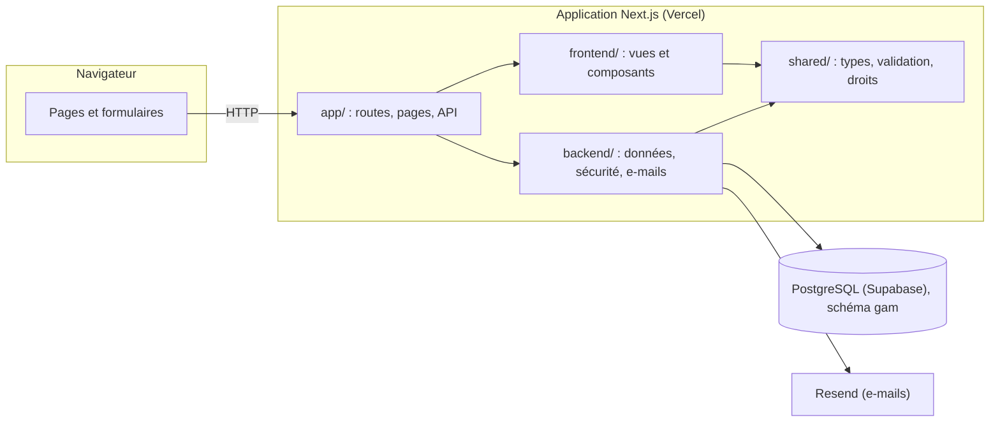

# Architecture

Une seule application Next.js (un seul déploiement Vercel), organisée en **trois couches séparées**, assemblées par les routes de `app/`. Ce choix évite d'exploiter deux services (une API et un site) pour un site vitrine doté d'un back-office, sans renoncer à la séparation : l'interface ne peut pas accéder à la base, et le serveur ne dépend pas de l'interface.



## Les couches

| Dossier | Rôle | Peut importer | Interdit |
|---|---|---|---|
| `shared/` | Types, constantes, règles de validation, matrice des droits | Rien d'autre que `shared/` | Toute dépendance (React, Next.js, Node.js) : ce code s'exécute dans le navigateur **et** sur le serveur |
| `frontend/` | Vues complètes (`views/`), composants, styles, images, configuration d'affichage | `shared/`, `react`, `next`, `lucide-react` | `backend/`, `next/headers`, `next/cache`, `server-only`, `postgres`, modules Node.js |
| `backend/` | Accès à la base, sessions, droits, anti-abus, e-mails, actions serveur | `shared/`, `react`, `next`, `server-only`, `postgres`, modules Node.js | `frontend/` |
| `app/` | Routes : chaque page lit ses données dans `backend/`, puis les passe à une vue de `frontend/` | Tout | — |

Ces règles sont **vérifiées automatiquement** par `npm run check:architecture` (`scripts/check-architecture.mjs`), qui analyse chaque import et échoue à la première violation. Deux protections s'y ajoutent :

- les modules de `backend/` qui touchent aux données, aux sessions, aux e-mails ou aux secrets importent `server-only` (les actions sont marquées `'use server'`) : la compilation échoue si l'un d'eux se retrouve dans du code envoyé au navigateur. Seuls en sont dispensés le contenu par défaut (`content/defaults.ts`), les noms d'étiquettes de cache (`content/tags.ts`) et le lanceur de migrations et le contenu initial (`db/migrate.ts`, `db/seed.ts`), utilisés aussi par les scripts en ligne de commande et sans aucun secret ;
- les variables secrètes ne sont lues que dans `backend/config/env.ts` (lui-même `server-only`). Next.js n'expose au navigateur que les variables préfixées `NEXT_PUBLIC_`, qui ne sont jamais secrètes.

Les vues de `frontend/` reçoivent tout par **props** : leurs données, mais aussi les actions serveur qu'elles déclenchent (`app/` les importe de `backend/actions/` et les transmet). Le navigateur ne reçoit pour une action qu'un identifiant opaque, jamais son code.

## Flux principaux

### 1. Page publique (statique)

```
Visiteur → page statique (déjà générée)
              ↑ générée par app/(site)/…/page.tsx
              → backend/modules/content/public.ts   lecture mise en cache (« use cache »)
              → backend/modules/content/repository.ts → PostgreSQL
              → frontend/views/site/…View.tsx         rendu
```

- Les lectures publiques sont des fonctions `'use cache'` étiquetées (`gam-content`, `gam-reviews`), avec le profil de cache `days` de Next.js (avis : `hours`) : la base n'est relue en arrière-plan qu'au plus une fois par jour (avis : une fois par heure), jamais à chaque visite.
- **Après une modification dans le back-office**, l'action serveur appelle `updateTag(...)` : les pages concernées sont régénérées à la requête suivante, et la modification est visible immédiatement.
- **Base absente ou injoignable** : le site s'affiche avec le contenu par défaut (`backend/modules/content/defaults.ts`). Ce repli utilise le profil `minutes` (nouvel essai au bout d'une minute environ).
- Les pages de prestation sont générées à la compilation (`generateStaticParams`). Une prestation créée ensuite est générée à sa première visite, puis mise en cache ; une adresse inconnue répond par une vraie erreur 404.

### 2. Demande de devis ou de contact

```
RequestForm (navigateur) → POST /api/demande (JSON, ou formulaire classique sans JavaScript)
  app/api/demande/route.ts : origine, taille (20 000 octets maximum), lecture du corps
  backend/modules/leads/service.ts (submitLead) :
    1. anti-abus partagé : 5 envois par adresse IP toutes les 10 minutes (compteur en base, IP réduite à une empreinte)
    2. champ piège et délai minimal de remplissage
    3. validation : shared/validation/request.ts (mêmes règles que dans le navigateur)
    4. enregistrement : une transaction (demande + prestations demandées)
    5. notification e-mail (backend/integrations/email.ts, Resend), puis suivi de l'envoi en base
  → 200 (reçue), 422 (champs à corriger), 429 ou 502 (avec le téléphone et l'e-mail pour joindre GAM CLEAN directement)
```

La demande est considérée comme reçue si elle est **enregistrée ou** si l'e-mail est parti. Un e-mail en échec est renvoyé par la tâche quotidienne.

### 3. Back-office

```
/admin/…  → proxy.ts : redirection rapide vers la connexion s'il n'y a aucun cookie de session (confort, pas protection)
          → page : requireAdmin(permission)        session en base + rôle, vérifiés côté serveur
          → backend/modules/…/repository.ts         requêtes paramétrées
          → frontend/views/admin/…View.tsx          rendu

Action (formulaire) → backend/actions/….ts ('use server')
          1. authorize(permission)                  session et rôle vérifiés à nouveau, dans l'action elle-même
          2. validation (shared/validation/)
          3. withActor(utilisateur, transaction)    l'auteur est transmis aux triggers (historique, modération)
          4. audit(...)                             journal, dans la même transaction
          5. updateTag(...) si le site public change, refresh() pour réafficher l'écran
```

- **Sessions** (`backend/modules/auth/session.ts`) : jeton aléatoire de 256 bits dans un cookie `HttpOnly`, `Secure`, `SameSite=Lax` (préfixe `__Host-` en production) ; seule son empreinte SHA-256 est en base. Durée de 12 h maximum, fermeture après 2 h d'inactivité, activité enregistrée au plus toutes les 5 minutes.
- **Droits** : une seule matrice (`shared/auth/permissions.ts`), utilisée par le serveur pour autoriser et par l'interface pour masquer ce qui n'est pas permis.
- **Formulaires** (`frontend/lib/use-form-action.ts`) : la saisie est conservée en cas d'erreur de validation (React 19 vide sinon le formulaire après chaque envoi). Au-delà de 15 secondes d'attente, un message propose de recharger la page au lieu de laisser un indicateur tourner sans fin.
- **Changements de page** : `app/admin/(espace)/loading.tsx` affiche immédiatement un état de chargement pendant que le serveur répond. Les layouts et pages du back-office déclarent `export const instant = false` : ils vérifient la session avant tout affichage, une attente que la validation « Instant » de Next.js signalerait sinon en développement.
- **Requêtes** : le layout lance la vérification de session et les compteurs du menu en parallèle ; les pages ne lisent leurs données qu'après la vérification de session et des droits.

### 4. Avis clients

```
Fiche d'une demande ou écran « Avis » → invitation (lien personnel à usage unique, 60 jours)
Client → /avis/<jeton> → empreinte du jeton recherchée en base → ReviewForm → avis « en attente »
Modération (publier, refuser…) → updateTag('gam-reviews') → témoignages de l'accueil mis à jour
```

La base garantit l'authenticité : contenu d'un avis immuable (trigger), publication impossible sans le consentement du client (contrainte), un seul avis par invitation (index unique).

### 5. Tâche quotidienne

```
Vercel Cron (vercel.json, 3 h 17 UTC) → GET /api/cron/maintenance, en-tête Authorization: Bearer <CRON_SECRET>
  comparaison à temps constant, sinon 401
  → gam.purge_expired_data()   données arrivées à échéance (RGPD)
  → nouvel envoi des notifications e-mail en échec (5 essais au plus, demandes de moins de 7 jours)
  → entrée dans le journal d'audit
```

## Rendu et performances

- `cacheComponents` : pages publiques **pré-générées** ; back-office rendu à la demande (il dépend du cookie de session).
- `partialPrefetching: false` : avec le préchargement partiel, une adresse de prestation inconnue recevait d'abord une page générique en 200 au lieu d'une erreur 404.
- CSS servi en fichiers plutôt qu'intégré au HTML : mesuré avec Lighthouse, l'intégration doublait le poids de chaque page et triplait le temps de blocage.
- Images importées dans le code : versions AVIF et WebP, tailles adaptées à l'écran et cache longue durée générés par Next.js.
- Polices auto-hébergées ; aucun script tiers par défaut.

## Base de données

Schéma, index, mesures et sécurité : [`BASE-DE-DONNEES.md`](BASE-DE-DONNEES.md).

## Arborescence

```
app/
  (site)/                     Site public : accueil, prestations/[slug], secteurs, a-propos, faq, devis, contact,
                              avis/[jeton], merci, envoi-impossible, mentions légales, confidentialité
    _lib/page-meta.ts         Métadonnées communes des pages
  admin/
    connexion/                Connexion
    (espace)/                 Pages protégées : tableau de bord, demandes, avis, contenu, utilisateurs, compte, journal
  api/
    demande/                  Réception des formulaires
    admin/export/demandes/    Export CSV (droits vérifiés)
    cron/maintenance/         Tâche quotidienne
  layout.tsx  not-found.tsx  sitemap.ts  robots.ts  manifest.ts  icônes et images de partage
frontend/
  views/site/  views/admin/   Une vue par page
  components/                 layout/ (en-tête, pied de page, barre mobile), sections/, forms/, admin/, ui/, seo/, analytics/
  assets/                     Images et logos (importés : optimisés à la compilation)
  styles/globals.css          Jetons de design (couleurs, typographie, espacements) et styles de base
  config/  lib/               Navigation, textes de l'interface, formatage, SEO, mesure d'audience
backend/
  config/env.ts               Seul point de lecture des variables d'environnement serveur
  db/                         Client PostgreSQL, lanceur de migrations, migrations SQL, contenu initial
  modules/                    content/, leads/, reviews/, users/, auth/, audit/, maintenance/
  actions/                    Actions serveur du back-office
  integrations/email.ts       Envoi des e-mails (Resend)
  security/                   Anti-abus, jetons et empreintes
shared/
  types/  constants/  validation/  auth/permissions.ts  config/site-url.ts
scripts/                      db:migrate, db:seed, admin:create, db:benchmark, e2e:prepare, check:architecture
tests/                        unit/ (node:test), db/ (PostgreSQL), e2e/ (Playwright + axe-core)
proxy.ts                      Redirection vers la connexion (back-office)
next.config.ts                En-têtes de sécurité, redirections de l'ancien site, images
vercel.json                   Tâche planifiée
```

## Ajouter une fonctionnalité : exemple

Ajouter un champ « délai d'intervention » à une prestation :

1. **Base** : nouvelle migration `backend/db/migrations/0004_delai_prestation.sql` (`alter table gam.services add column …` avec sa contrainte `CHECK`).
2. **Shared** : le champ dans `shared/types/content.ts`, sa règle dans `shared/validation/content.ts`, et un test dans `tests/unit/`.
3. **Backend** : lecture et écriture dans `backend/modules/content/repository.ts`. L'action existante appelle déjà la validation et `updateTag`.
4. **Frontend** : le champ dans `frontend/views/admin/ServiceEditorView.tsx` et son affichage dans `frontend/views/site/ServiceView.tsx`.
5. **Vérifier** : `npm run typecheck`, `npm run check:architecture`, `npm test`, `npm run test:db`, puis `npm run db:migrate` sur la base réelle.
