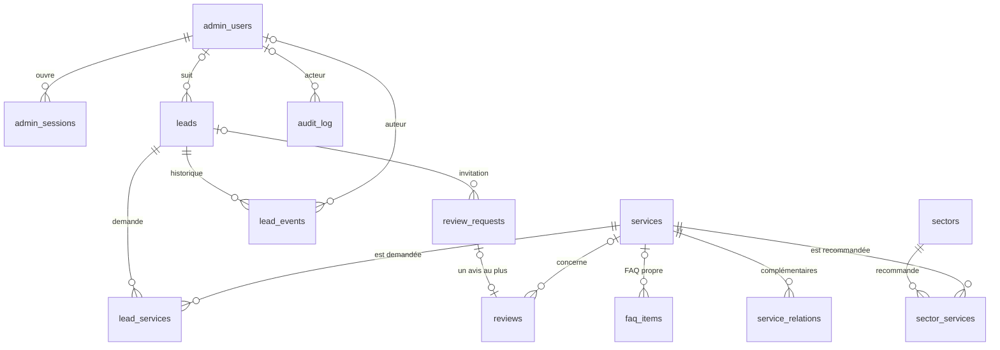

# Base de données

PostgreSQL 15 ou plus récent (Supabase), schéma `gam`. Les migrations sont dans `backend/db/migrations/` :

| Fichier | Contenu |
|---|---|
| `0001_schema.sql` | Types, tables, contraintes, index, fonctions de recherche |
| `0002_functions.sql` | Triggers (dates, historique, immuabilité des avis), anti-abus, purge |
| `0003_security.sql` | Retrait des droits publics, rôle applicatif `gam_app`, sécurité au niveau des lignes |

Extensions utilisées : `pg_trgm` (recherche par trigrammes) et `unaccent` (recherche sans accents), installées dans le schéma `extensions`, comme le fait Supabase.

---

## Sommaire

1. [Modèle de données](#modèle-de-données)
2. [Principes d'optimisation](#principes-doptimisation)
3. [Index et requêtes servies](#index-et-requêtes-servies)
4. [Triggers et fonctions](#triggers-et-fonctions)
5. [Faire évoluer le schéma](#faire-évoluer-le-schéma)
6. [Conservation des données (RGPD)](#conservation-des-données-rgpd)
7. [Sécurité](#sécurité)
8. [Rôle de connexion à privilèges minimaux](#rôle-de-connexion-à-privilèges-minimaux)
9. [Mesures](#mesures)
10. [Compromis assumés et limites](#compromis-assumés-et-limites)
11. [Sauvegardes](#sauvegardes)

---

## Modèle de données



| Table | Contenu | Clé primaire | Particularités |
|---|---|---|---|
| `admin_users` | Comptes du back-office | `smallint` | E-mail unique en minuscules, hachage scrypt obligatoire (`CHECK`), compteur d'échecs et verrouillage |
| `admin_sessions` | Sessions ouvertes | `bigint` | Seule l'empreinte SHA-256 du jeton est stockée ; `fillfactor 90` |
| `site_settings` | Coordonnées et informations légales | `boolean` (`id = true`) | **Une seule ligne**, garantie par la contrainte ; formats légaux contrôlés (SIRET, TVA, APE) |
| `claims` | Affirmations commerciales | `text` (clé) | Affichées seulement si `is_confirmed` |
| `services` | Prestations | `smallint` | Listes ordonnées en `text[]` / `jsonb` (lues en un seul accès, sans jointure) |
| `service_relations` | Prestations complémentaires | `(service_id, related_id)` | Interdit de se lier à soi-même |
| `faq_items` | Questions fréquentes | `smallint` | `service_id` vide = FAQ générale |
| `sectors`, `sector_services` | Secteurs d'activité et prestations recommandées | `smallint` / composite | — |
| `leads` | Demandes de devis et de contact | `bigint` | Règles métier en contraintes (un devis exige ville et téléphone, un contact exige un message) ; `fillfactor 90` |
| `lead_services` | Prestations demandées (n-n) | `(lead_id, service_id)` | Une prestation déjà demandée ne peut pas être supprimée (`ON DELETE RESTRICT`) : on la dépublie |
| `lead_events` | Historique d'une demande (statuts, notes, assignations, notifications) | `bigint` | Statuts et assignations écrits par trigger, avec leur auteur |
| `review_requests` | Invitations à laisser un avis | `bigint` | Lien à usage unique : empreinte du jeton, date d'expiration, date d'utilisation |
| `reviews` | Avis clients | `bigint` | Contenu immuable (trigger), publication impossible sans consentement (contrainte), un avis par invitation (index unique partiel) |
| `audit_log` | Journal des actions | `bigint` | Alimenté en ajout seul par l'application ; index BRIN |
| `rate_limits` | Compteurs anti-abus | empreinte (32 octets) | `UNLOGGED` : contenu jetable, écritures rapides |
| `schema_migrations` | Migrations appliquées | `integer` | Créée par le lanceur, réservée au propriétaire |

Les listes fermées (statuts, types, profils, rôles, icônes) sont des **types énumérés** : 4 octets par valeur, et la base refuse toute valeur hors liste.

## Principes d'optimisation

1. **Types au plus juste.** `smallint` (2 octets) pour les petites tables de référence et les clés étrangères qui y pointent ; `bigint` identity pour les tables qui grossissent ; énumérations plutôt que texte libre ; `timestamptz` partout.
2. **Colonnes ordonnées par alignement** (8 → 4 → 2 → 1 octet → longueur variable) : pas d'octets de remplissage dans les lignes.
3. **Intégrité garantie par la base**, pas seulement par l'application : `NOT NULL`, `CHECK` (formats, longueurs, bornes), clés étrangères avec action de suppression explicite. Les mêmes règles sont appliquées dans le navigateur et sur le serveur (`shared/validation/`), puis par la base.
4. **Un index seulement pour une requête réellement exécutée, une contrainte d'unicité ou une clé étrangère** (section suivante). Chaque index ralentit les écritures et occupe de la mémoire : aucun index « au cas où ».
5. **Index chronologiques en ordre croissant.** Les nouvelles demandes arrivent en fin d'index (pages remplies à 90 %), et PostgreSQL lit l'index à rebours pour les tris « plus récent d'abord ». Mesuré avec 100 000 demandes insérées au fil du temps : 3 088 Ko pour `(created_at, id)` contre 5 520 Ko en ordre décroissant, et 6 728 Ko contre 7 112 Ko pour `(status, created_at, id)`.
6. **Pagination par curseur** (`created_at`, `id`) au lieu de `OFFSET` : le coût d'une page ne dépend pas de sa profondeur.
7. **Agrégats en un seul passage.** Le tableau de bord calcule tous ses compteurs en une lecture de la table (`count(*) filter (where …)`), au lieu d'une requête par compteur.
8. **Recherche sans stockage en double.** Index trigrammes sur une expression (`gam.lead_search_document(...)`) plutôt qu'une colonne générée : 215 octets par demande au lieu de 292 (−26 %).
9. **Fonctions de recherche rapides.** Elles sont évaluées pour chaque ligne examinée. Elles utilisent donc un corps SQL standard (`RETURN …`), lié aux objets dès la création et insensible au `search_path`, plutôt qu'une clause `SET search_path`. Le coût mesuré passe de 15 à 3 µs par ligne (voir [Mesures](#mesures)). Les autres fonctions (triggers, purge, anti-abus) gardent `SET search_path = ''`.
10. **`fillfactor 90`** sur `leads` et `admin_sessions`. Chaque page garde 10 % de place libre : une mise à jour qui ne modifie aucune colonne indexée reste sur la même page sans toucher aux index (mise à jour « HOT »). Vérifié sur la base de test : c'est le cas de l'activité d'une session (`last_seen_at`) et de l'ajout d'une note (seule `updated_at` change). Un changement de statut ou l'enregistrement d'une notification modifient une colonne indexée et ne sont pas HOT : c'est attendu, ces opérations sont rares.
11. **Table `UNLOGGED`** pour l'anti-abus : pas d'écriture dans le journal de transactions. Son contenu est perdu après un arrêt brutal du serveur, ce qui est sans conséquence pour des compteurs de 10 minutes.
12. **Pas de jointure pour afficher une page publique.** Les listes ordonnées d'une prestation (étapes, inclusions, groupes) sont en `text[]` / `jsonb`, et les pages publiques sont de toute façon statiques : la base n'est lue qu'à la génération, après une modification, puis au plus une fois par jour.

## Index et requêtes servies

| Index | Requête servie |
|---|---|
| `leads_created_idx (created_at, id)` | Liste des demandes, tri « plus récent d'abord » et pagination par curseur, filtres par période |
| `leads_status_created_idx (status, created_at, id)` | Filtre par statut ; badge « nouvelles demandes » du menu, compté sur l'index seul (sans lire la table) |
| `leads_search_trgm_idx` (GIN trigrammes sur `lead_search_document`) | Recherche par nom, e-mail, société, ville ou téléphone, sans accents et sans casse, sur n'importe quelle partie du texte |
| `leads_assigned_to_idx (assigned_to, created_at)` partiel | Filtre « personne en charge » ; ne contient que les demandes assignées |
| `leads_pending_notification_idx (created_at)` partiel | Relance nocturne des e-mails en échec ; ne contient que les demandes non notifiées (32 Ko dans le jeu de mesure) |
| `lead_services_pkey (lead_id, service_id)` | Prestations d'une demande ; filtre par prestation (lecture de l'index seul) |
| `lead_services_service_id_idx` | Contrôle de la clé étrangère à la suppression d'une prestation (sinon parcours complet de la table) |
| `lead_events_lead_created_idx (lead_id, created_at)` | Historique d'une demande |
| `admin_sessions_token_hash_key` (unique) | Lecture de la session à chaque page du back-office |
| `admin_sessions_user_id_idx`, `admin_sessions_expires_at_idx` | Fermeture des sessions d'un compte ; purge des sessions expirées |
| `reviews_published_idx` partiel | Avis publiés affichés sur le site |
| `reviews_pending_idx` partiel, `reviews_created_idx` | Avis à modérer ; liste complète de la modération |
| `reviews_request_id_key` (unique, partiel) | Un seul avis par invitation |
| `review_requests_token_hash_key` (unique), `review_requests_created_idx`, `review_requests_lead_id_idx` | Ouverture d'un lien d'avis ; liste des invitations ; invitations d'une demande |
| `services_slug_key`, `sectors_slug_key` (uniques) | Unicité des adresses de page |
| `faq_items_scope_position_idx (service_id, position, id)` | Clé étrangère vers la prestation (suppression en cascade), dans l'ordre d'affichage |
| `service_relations_related_id_idx`, `sector_services_service_id_idx` | Clés étrangères (suppressions en cascade sans parcours complet) |
| `audit_log_created_brin` (BRIN) | Purge du journal par date (24 Ko pour 100 000 lignes) ; l'affichage utilise la clé primaire croissante |

Les petites tables de contenu (quelques dizaines de lignes) sont lues en entier par PostgreSQL, ce qui est plus rapide qu'un index à cette taille : 4 à 6 pages lues pour l'habillage du site ou une page de prestation (voir [Mesures](#mesures)).

Index volontairement **absents** :

- Ordre d'affichage des prestations : 7 lignes, lues en entier.
- `audit_log` par auteur : aucune requête ne filtre le journal ainsi.
- Colonnes « auteur » qui pointent vers un compte (`actor_id`, `assignee_id`, `created_by`, `moderated_by`, `updated_by`) : un compte n'est jamais supprimé, seulement désactivé. Ces index ne serviraient donc qu'à une suppression manuelle exceptionnelle, qui peut se permettre un parcours complet.
- `leads.updated_at` : seule la purge quotidienne s'en sert. Un index ralentirait chaque mise à jour d'une demande et empêcherait les mises à jour HOT, pour une requête exécutée une fois par jour (parcours complet de quelques dizaines de millisecondes à 100 000 demandes).

## Triggers et fonctions

| Objet | Rôle |
|---|---|
| `touch_updated_at` | Met à jour `updated_at` sur les contenus et les comptes |
| `leads_before_update` | Met à jour `updated_at`, et `status_changed_at` si le statut change |
| `leads_log_changes` | Écrit dans `lead_events` chaque changement de statut ou d'assignation, avec son auteur. Il ne se déclenche que si l'une de ces colonnes change réellement (`WHEN`) |
| `reviews_before_update` | Refuse toute modification du contenu d'un avis ; date et signe la modération |
| `current_actor()` | Lit l'administrateur à l'origine de la transaction (`set_config('gam.actor_id', …, true)`, posé par `withActor()` dans `backend/db/client.ts`) |
| `rate_limit_hit()` | Compteur anti-abus atomique (`INSERT … ON CONFLICT`), partagé entre toutes les instances Vercel |
| `purge_expired_data()` | Purge quotidienne (section RGPD), renvoie le nombre de lignes supprimées par table |
| `normalize_search()`, `lead_search_document()` | Texte de recherche en minuscules et sans accents (index trigrammes) |

## Faire évoluer le schéma

- `npm run db:migrate` applique les fichiers `backend/db/migrations/NNNN_nom.sql` absents de `gam.schema_migrations`, dans l'ordre. Chaque fichier est appliqué dans **sa propre transaction** : une erreur n'en laisse rien.
- Un **verrou consultatif** empêche deux exécutions simultanées d'appliquer la même migration.
- L'**empreinte SHA-256** de chaque fichier appliqué est enregistrée. Si un fichier déjà appliqué est modifié, la commande échoue au lieu de l'ignorer.
- Pour toute évolution : **ajoutez un nouveau fichier** (`0004_…sql`), ne modifiez jamais un fichier appliqué en production.
- Après une évolution qui ajoute une table, vérifiez qu'elle reçoit la sécurité au niveau des lignes et la politique `gam_app_all`. Le plus simple est de reprendre la boucle de `0003_security.sql` dans la nouvelle migration. Les droits du rôle `gam_app`, eux, sont accordés automatiquement par les privilèges par défaut, à condition d'exécuter les migrations avec le même rôle propriétaire.
- `npm run db:seed` n'insère que le contenu manquant et n'écrase jamais une modification faite dans le back-office.

## Conservation des données (RGPD)

La tâche quotidienne (`/api/cron/maintenance`) appelle `gam.purge_expired_data()`, qui supprime :

| Données | Règle |
|---|---|
| Demandes | Sans activité depuis la durée de conservation (`site_settings.lead_retention_months`, **36 mois par défaut**, réglable de 6 à 120 mois dans le back-office). L'activité est `updated_at`, mise à jour à chaque changement de statut ou d'assignation et à chaque note. Historique et prestations liés sont supprimés en cascade |
| Sessions | Expirées |
| Invitations à laisser un avis | Jamais utilisées et expirées depuis 30 jours |
| Compteurs anti-abus | Plus d'un jour |
| Journal d'audit | Plus de 24 mois |

Une demande peut aussi être supprimée immédiatement depuis sa fiche (droit à l'effacement). La durée de 36 mois est une valeur par défaut technique : **à valider par GAM CLEAN** au regard de ses obligations. Les avis publiés ne sont pas purgés automatiquement : ils sont supprimés à la demande de leur auteur.

## Sécurité

Trois barrières indépendantes (`0003_security.sql`) :

1. **Schéma non exposé.** L'API REST automatique de Supabase n'expose que les schémas déclarés dans *Settings → API* (par défaut `public` et `graphql_public`). N'y ajoutez pas `gam` : le site n'accède à la base que depuis le serveur.
2. **Aucun droit pour les rôles publics.** Tous les droits sur le schéma, ses tables, séquences et fonctions sont retirés à `PUBLIC` (y compris pour les objets créés plus tard, par les privilèges par défaut) et aux rôles `anon`, `authenticated` et `service_role` de Supabase. Sans droit d'usage sur le schéma, ces rôles ne peuvent atteindre aucun objet qu'il contient.
3. **Sécurité au niveau des lignes (RLS)** sur toutes les tables. Seul le rôle `gam_app` dispose d'une politique d'accès. Le registre des migrations n'en a aucune : il est refusé à tous sauf au propriétaire.

À cela s'ajoutent :

- des requêtes **toujours paramétrées** (gabarits `postgres.js`), sans concaténation de valeurs dans le SQL ;
- les jetons de session et d'invitation **jamais stockés en clair** (empreinte SHA-256), les mots de passe hachés avec scrypt et les adresses IP réduites à une empreinte (HMAC avec `APP_SECRET`) ;
- une connexion chiffrée : SSL exigé hors réseau local, sauf si l'URL précise elle-même `sslmode`.

Testé (`npm run test:db`, PostgreSQL 16 local ; le test crée les rôles `anon`, `authenticated` et `service_role` s'ils n'existent pas) : ces rôles n'ont aucun droit, `gam_app` lit et écrit mais n'accède pas au registre des migrations, et la RLS est active sur toutes les tables.

## Rôle de connexion à privilèges minimaux

Par défaut, le site se connecte avec le rôle propriétaire fourni par Supabase (`postgres`), qui peut tout faire, y compris modifier le schéma. Pour limiter les dégâts possibles en cas de fuite de `DATABASE_URL`, créez un rôle de connexion qui hérite **uniquement** des droits de `gam_app`, c'est-à-dire lire et écrire les données, sans pouvoir modifier le schéma ni lire le registre des migrations.

Dans Supabase, **SQL Editor** (avec un mot de passe long et aléatoire, par exemple `openssl rand -base64 32`) :

```sql
create role gam_site login password 'MOT-DE-PASSE-ALÉATOIRE';
grant gam_app to gam_site;
```

Puis :

- `DATABASE_URL` (site, Vercel) : la chaîne du *Transaction pooler* avec ce rôle et ce mot de passe. Le format du nom d'utilisateur attendu par le pooler de Supabase (généralement `gam_site.<référence-du-projet>`) est **à vérifier** dans la documentation Supabase au moment de la mise en place.
- `DATABASE_URL_MIGRATIONS` (migrations, poste de travail) : garde le rôle propriétaire.

Vérifié localement (PostgreSQL 16) avec un rôle créé de cette façon : lecture, écriture, triggers, anti-abus et purge fonctionnent ; le registre des migrations et la création de table sont refusés. **Non vérifié** sur un projet Supabase réel.

## Mesures

`npm run db:benchmark` recrée le schéma dans une base de test (`*_test`, vidée) et génère un volume synthétique : 100 000 demandes réparties sur près de 3 ans, 137 500 événements, 125 000 liens demande-prestation et 100 000 entrées de journal. Le script exécute ensuite les **vraies fonctions du backend** en capturant leur SQL, puis passe chaque requête à `EXPLAIN (ANALYZE, BUFFERS)`, cinq fois, et retient la médiane.

Environnement de mesure : PostgreSQL 16 local (machine de développement), données en mémoire. **La latence réseau entre Vercel et Supabase s'y ajoute en production et n'est pas mesurée ici.** Pour donner un ordre de grandeur, 100 000 demandes représentent bien plus que l'activité attendue d'une entreprise de nettoyage : le volume réel attendu de GAM CLEAN n'est pas connu.

### Taille des tables (100 000 demandes)

Valeurs telles qu'affichées par PostgreSQL (`pg_size_pretty`, 1 Mo = 1 024 Ko).

| Table | Lignes | Données | Index | Octets par ligne (moyenne, en-têtes inclus) |
|---|---:|---:|---:|---:|
| `leads` | 100 000 | 21 Mo | 29 Mo (dont 16 Mo pour l'index de recherche) | 215 |
| `lead_events` | 137 500 | 12 Mo | 8 432 Ko | 88 |
| `lead_services` | 125 000 | 5 408 Ko | 4 696 Ko | 44 |
| `audit_log` | 100 000 | 7 400 Ko | 2 256 Ko | 76 |

### Temps des requêtes de l'application

| Requête | Temps médian | Pages lues | Accès utilisé |
|---|---:|---:|---|
| Liste des demandes, 1re page | 0,21 ms | 86 | Index `leads_created_idx` |
| Liste filtrée « Nouvelles » | 0,18 ms | 89 | Index `leads_created_idx` |
| Page profonde (après 20 000 demandes), par curseur | 0,24 ms | 86 | Index `leads_created_idx` |
| Recherche par téléphone partiel | 0,20 ms | 23 | Index trigrammes |
| Recherche large « dubois léa » (834 résultats) | 9,16 ms | 188 | Index `leads_created_idx` + filtre |
| Filtre prestation + période | 0,43 ms | 545 | Index `leads_created_idx` + clé de `lead_services` |
| Badge « nouvelles demandes » (chaque page du back-office) | 2,01 ms | 114 | Lecture de l'index seul |
| Compteurs par statut (onglets de la liste) | 22,25 ms | 2 624 | Parcours complet |
| Indicateurs du tableau de bord | 32,99 ms | 2 624 | Parcours complet, un seul passage |
| Fiche d'une demande + historique (2 requêtes) | 0,13 ms | 10 | Clé primaire, index de l'historique |
| Notifications à renvoyer (tâche nocturne) | 0,02 ms | 6 | Index partiel |
| Journal, 1re page | 0,08 ms | 14 | Clé primaire |
| Habillage du site (coordonnées, prestations) | 0,14 ms | 4 | Petites tables |
| Page d'une prestation | 0,09 ms | 6 | Petites tables |

Comparaison : une pagination classique par `OFFSET 20 000` prend 2,74 ms (elle relit les 20 000 lignes sautées), contre 0,24 ms par curseur. L'écart croît avec la profondeur.

Les temps varient d'une exécution à l'autre : sur cinq exécutions avec la même structure de table, le tableau de bord a pris entre 31 et 46 ms. Les valeurs ci-dessus sont celles de la dernière exécution, sur le schéma livré.

### Recherche : effet des fonctions à corps SQL standard

Une recherche large examine des centaines ou des milliers de lignes et calcule pour chacune le texte normalisé. Mesures sur 100 000 demandes :

| Version des fonctions de recherche | Coût par ligne (parcours complet) | Recherche large, plan « index chronologique » | Recherche large, plan « index trigrammes » |
|---|---:|---:|---:|
| Avec `SET search_path = ''` (version précédente) | 15 µs | 40,9 ms | 15,6 ms |
| Corps SQL standard (version livrée) | 3 µs | 9,2 à 14,8 ms | 7,3 à 9,8 ms |

Selon ses statistiques, PostgreSQL choisit l'un ou l'autre plan : les deux sont désormais du même ordre.

## Compromis assumés et limites

- **Recherche par expression plutôt que colonne stockée.** Elle évite de stocker le texte en double (−26 % par ligne), mais une recherche large recalcule le texte normalisé pour chaque ligne examinée. Une colonne générée stockée ramenait la même recherche à environ 2 à 4 ms (mesuré avant ce choix), au prix de 77 octets de plus par demande. Si la recherche devenait lente à fort volume, revenir à une colonne générée est une migration simple.
- **Compteurs par statut et tableau de bord en parcours complet.** Leur coût croît avec le nombre de demandes (environ 22 et 33 ms à 100 000). Si ce coût devenait gênant, la solution serait une table de compteurs tenue par trigger. Elle n'est pas mise en place : elle alourdirait chaque écriture pour gagner quelques dizaines de millisecondes à ce volume, sur un écran consulté par quelques personnes.
- **Taille de l'index par statut.** Les demandes s'insèrent à six endroits de l'index (un par statut), dont les pages se remplissent donc moins bien que celles de l'index chronologique (6,7 Mo contre 3,1 Mo à 100 000 demandes). Ce coût est accepté pour le badge du menu.
- **Pas de partitionnement.** Il n'apporterait rien sous plusieurs millions de lignes et compliquerait la purge et les clés étrangères.
- **Mesures locales.** Les temps ci-dessus excluent le réseau et ont été obtenus sur PostgreSQL 16 local, pas sur l'infrastructure Supabase.

## Sauvegardes

Les sauvegardes dépendent de l'offre Supabase choisie (sauvegardes quotidiennes, restauration à un instant donné en option) : **vérifiez ce qui est inclus** sur supabase.com/pricing. Indépendamment de l'offre, une exportation régulière avec `pg_dump` vers un stockage séparé protège contre une suppression accidentelle du projet :

```bash
pg_dump "$DATABASE_URL_MIGRATIONS" --schema=gam --format=custom --file=gam-$(date +%F).dump
```

Le fichier contient des données personnelles de prospects : stockez-le chiffré et appliquez-lui la même durée de conservation.
